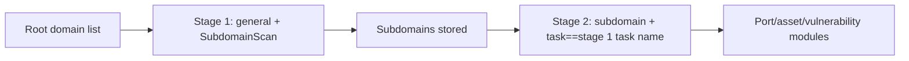

---

## name: scopesentry-mcp
description: Manage the ScopeSentry security scanning platform (projects, tasks, templates, assets, nodes) through ScopeSentry MCP. Use when the user mentions ScopeSentry, MCP, API Key, scan tasks, or asset queries.
---

# ScopeSentry MCP Usage Guide

For users with a **deployed ScopeSentry instance**. Connect to the platform through Cursor (or another MCP client) without local source code.

## 1. Preparation

### 1.1 Confirm the Service Is Reachable

- Default web UI: `http://<host>`
- MCP endpoint: `http://<host>/mcp` (if there is a reverse proxy or frontend proxy, use the actual `/mcp` address)

### 1.2 Create an API Key

1. Log in to the ScopeSentry web UI in a browser
2. Go to the **API Key** management page to create a key (or use the interface provided by an administrator)
3. Save the returned `ssk_...` string (**shown only once**)

### 1.3 Configure Cursor MCP

Cursor → Settings → MCP → add a server:

```json
{
  "mcpServers": {
    "scopesentry": {
      "url": "http://<your-host>:8082/mcp",
      "headers": {
        "X-API-Key": "ssk_your_key"
      }
    }
  }
}
```

You can also use: `Authorization: Bearer ssk_your_key`

After configuration, restart MCP or reload Cursor and confirm that tools such as `list_projects` and `list_assets` appear in the tool list.

---

## 2. Tool Overview

| Tool                     | Purpose                |
| ---------------------- | ----------------- |
| `list_projects`        | Project tree grouped by tags (includes project IDs) |
| `list_projects_data`   | Paginated project list, searchable by name     |
| `get_project`          | Project details              |
| `create_project`       | Create a project              |
| `list_tasks`           | Scan task list            |
| `get_task`             | Task details              |
| `list_scan_templates`  | Scan template list            |
| `get_scan_template`    | Template details              |
| `list_plugin_modules`  | Scan pipeline module names          |
| `list_plugins`         | Available plugins (includes hash and default parameters) |
| `create_scan_template` | Create a scan template            |
| `create_scan_task`     | Create a scan task            |
| `list_assets`          | Query asset types (paginated list)       |
| `count_assets`         | Count assets (`/api/assets/common/total`) |
| `get_asset_detail`     | Asset or vulnerability details           |
| `add_asset_tag`        | Add a tag to an asset           |
| `list_nodes`           | Scan node list            |

Tool parameters follow the MCP tool descriptions (schema). `list_assets` / `count_assets` share the same search and filter syntax; read the `list_assets` description before querying assets.

Use `count_assets` when you need to know “how many records there are” (equivalent to the total count API used by web pagination), instead of paging `list_assets` repeatedly just to count.

---

## 3. Common Workflows

### 3.1 Query Assets by Project

When the user or context **already has a project condition**, prefer passing `filter.project` to narrow the scope and avoid slow responses caused by cross-project data. If there is no explicit project, do not force project filtering.

1. Use `list_projects` or `list_projects_data` to get the target project's **ObjectID** (`id` / `children[].value`)
2. Pass `filter.project` to `list_assets` (**must be an ID, not the project display name**)

```json
{
  "asset_type": "asset",
  "pageIndex": 1,
  "pageSize": 20,
  "search": "domain=^example.com",
  "filter": {
    "project": ["<project ObjectID>"]
  }
}
```

### 3.2 Create a Scan Task

1. Use `list_nodes` to get online node names
2. Use `list_scan_templates` or `create_scan_template` to get a template **ObjectID**
3. Call `create_scan_task`: `name` and `node` are required; `template` must be the template ID (not the template name)

**Target source `targetSource` (consistent with the web UI):**

| targetSource | Description | Required parameters |
| --- | --- | --- |
| `general` | Enter targets directly | `target` |
| `project` | Read targets from a project | `project` (project ObjectID array) |
| `asset` | Search from the web asset library | `search`; optional `project`, `filter`, `targetNumber` |
| `RootDomain` | Search from the root domain library | `search`; optional `project`, `filter`, `targetNumber` |
| `subdomain` | Search from the subdomain library | `search`; optional `project`, `filter`, `targetNumber` |
| `UrlScan` | Search from URL scan results | `search`; optional `project`, `filter`, `targetNumber` |
| `*Source` (e.g., `subdomainSource`) | Create from selected/searched assets on the asset page | `targetTp=search` uses `search`; `targetTp=select` uses `targetIds` |

**Example — scan root domains directly:**

```json
{
  "name": "example-subdomain-discovery",
  "node": ["node-1"],
  "template": "<template ObjectID>",
  "targetSource": "general",
  "target": "example.com\nfoo.com",
  "project": ["<project ObjectID>"]
}
```

**Example — continue scanning from the subdomain library (filter by the previous task name):**

```json
{
  "name": "example-port-and-vuln",
  "node": ["node-1"],
  "template": "<follow-up module template ObjectID>",
  "targetSource": "subdomain",
  "search": "task==\"example-subdomain-discovery\"",
  "project": ["<project ObjectID>"]
}
```

### 3.3 Complete Information Collection for Root Domains (recommended two stages)

When the input is a **root domain** and you need **complete information collection**, split the work into two scans instead of running the full pipeline at once.

**Reason:** distributed tasks are assigned by **individual target**. If a root domain is used as the target, the node assigned that root domain will continue to run subsequent modules on the subdomains discovered by that node, which can cause load imbalance, slower performance, and errors.

**Best practice:**

1. **Stage 1 — subdomain collection only**
   - `targetSource`: `general`
   - `target`: all root domains (multiple lines)
   - Template: enable only `SubdomainScan` and `SubdomainSecurity` (subdomain scanning + subdomain takeover)
   - Use `get_task` to wait for task completion

2. **Stage 2 — subsequent modules**
   - `targetSource`: `subdomain`
   - `search`: `task=="<stage 1 task name>"` (exact task name match)
   - Optional `project` to narrow the scope
   - Template: port scanning, asset mapping, vulnerability scanning, etc. (can omit SubdomainScan)
   - Subdomains are distributed as independent targets across nodes for better parallel efficiency

You can also filter by task name on the “Subdomains” asset page in the web UI and use “Create task from subdomains”, with the same effect.



### 3.4 Create a Scan Template

1. `list_plugin_modules` → list of module names
2. `list_plugins` (optionally filter by `module`) → each plugin's `hash` and default `parameter`
3. `create_scan_template`: use `modules` to specify “module → plugin hash array”

---

## 4. Asset Queries (`list_assets` / `count_assets`)

`count_assets` uses the same `asset_type`, `search`, and `filter` as `list_assets` and returns `{ "total": N }`, equivalent to the web `/api/assets/common/total` endpoint.

```json
{
  "asset_type": "subdomain",
  "search": "task==\"some task name\"",
  "filter": {"project": ["<project ObjectID>"]}
}
```

**Performance recommendations (for both `list_assets` / `count_assets`):** when a project condition exists, prefer `filter.project` to narrow scope; in `search`, prefer `==` exact match or `^` prefix match for indexed fields (see [4.3](#43-search-expressions)) and avoid broad `=` fuzzy queries that slow responses. Do not force project filtering when there is no project context.

See the table in [4.4](#44-filter-exact-filtering) for asset types that support `filter.project`.

### 4.1 Asset Types `asset_type`

`asset`, `RootDomain`, `subdomain`, `app`, `mp`, `UrlScan`, `SensitiveResult`, `DirScanResult`, `crawler`, `vulnerability`, `PageMonitoring`, `IPAsset`, `SubdomainTakerResult`

Alias examples: `web`→asset, `vuln`→vulnerability, `ip`→IPAsset, `url`→UrlScan

### 4.2 Parameter Description

| Parameter                       | Description                                      |
| ------------------------ | --------------------------------------- |
| `pageIndex` / `pageSize` | Pagination, defaults 1 / 20                            |
| `search`                 | Search expression (see below)                              |
| `filter`                 | Exact filter JSON (see below)                          |
| `sort`                   | Only UrlScan and DirScanResult support sorting by `length` |
| `sid`                    | SensitiveResult only: sensitive rule name                |

`search` and `filter` **can be used together**.

### 4.3 search Expressions

Custom DSL (**not SQL**):

| Operator  | Meaning   | Index | Example                          |
| ---- | ---- | ---- | --------------------------- |
| `=`  | Fuzzy match (regex) | does not use index | `domain=example`            |
| `==` | Exact match (equality) | **uses index** | `port==443`                 |
| `!=` | Exclude   | — | `port!="80"`                |
| `&&` | AND    | — | `domain==example.com && port==443` |
| `||` | OR    | — | `title=admin || body=login` |

**Indexing and operators:** fields such as `domain`, `ip`, `port`, and `title` are indexed, but only **`==` exact equality** or **prefix matches where the value starts with `^`** (such as `domain=^example.com`) can use the index; **`=` becomes a regex fuzzy match and cannot use the index**, which can be slow on large datasets.

**Common search fields for all types:** `tag`, `task` (task name), `rootDomain`

**Do not put `project` in search** (it is ineffective or causes errors when combined with `&&`). Use `filter.project` to filter by project.

**Common search fields by type:**

| asset_type           | Fields                                                                                  |
| -------------------- | ----------------------------------------------------------------------------------- |
| asset                | domain, ip, port, service, app, title, statuscode, icon, banner, type, body, header |
| RootDomain           | domain, icp, company                                                                |
| subdomain            | domain, ip, type, value                                                             |
| app                  | name, icp, company, category, description, url, apk                                 |
| mp                   | name, icp, company, category, description, url                                      |
| UrlScan              | url, input, source, resultId, type                                                  |
| SensitiveResult      | url, sname, body, info, md5                                                         |
| DirScanResult        | url, statuscode, redirect, length                                                   |
| vulnerability        | url, vulname, matched, request, response, level                                     |
| crawler              | url, method, body, resultId                                                         |
| PageMonitoring       | url, hash, diff, response                                                           |
| IPAsset              | ip, domain, port, service, webServer, app                                           |
| SubdomainTakerResult | domain, value, type, response                                                       |

**search examples:**

- `domain==www.example.com && port==443` (exact match, uses index)
- `domain=^example.com` (prefix match, uses index)
- `ip==192.168.1.1`
- `task=="some task name"`
- `level==high` (vulnerability)
- `statuscode==200` (DirScanResult)

Use `=` only when you need fuzzy containment, such as `title=admin` (does not use index; combine with project or other conditions to narrow scope).

### 4.4 filter Exact Filtering

JSON object: multiple values under the same key are **OR**; different keys are **AND**.

**Prefer `project` when a project condition exists:** if the user or context has an explicit project and the asset_type supports `project`, include it to narrow scope; do not force it when there is no project information.

| filter key   | Meaning       | Value notes                                                     |
| ------------ | -------- | -------------------------------------------------------- |
| `project`    | Owning project     | **ObjectID**; obtain via `list_projects` / `list_projects_data` |
| `task`       | Source task     | **Task name**; use `name` from `list_tasks`                         |
| `port`       | Port       | e.g., `"443"`                                                |
| `service`    | Service/protocol    | e.g., `"https"`                                              |
| `app`        | Application fingerprint     | e.g., `"Nginx"`                                              |
| `icon`       | Icon hash  |                                                          |
| `statuscode` | HTTP status code | Mainly used for asset                                               |
| `status`     | Status       | HTTP code for UrlScan/DirScan; processing status for vulnerability/sensitive info                       |
| `level`      | Vulnerability severity     | critical / high / medium / low / info                    |
| `type`       | Type       | e.g., subdomain record type A, CNAME                                         |
| `color`      | Sensitive rule color   | SensitiveResult                                          |
| `sname`      | Sensitive rule name    | SensitiveResult                                          |
| `tags`       | Tags       |                                                          |

**Available filter keys by type:**

| asset_type                            | filter keys                                                      |
| ------------------------------------- | --------------------------------------------------------------- |
| asset                                 | project, port, service, app, icon, statuscode, type, task, tags |
| RootDomain                            | project, tags                                                   |
| subdomain                             | project, type, task, tags                                       |
| app / mp                              | project, tags                                                   |
| UrlScan                               | status, tags                                                    |
| DirScanResult                         | status, tags                                                    |
| SensitiveResult                       | status, color, sname, tags                                      |
| crawler                               | project, task, tags                                             |
| vulnerability                         | project, level, status, task, tags                              |
| PageMonitoring / SubdomainTakerResult | tags                                                            |
| IPAsset                               | project, port, service, app                                     |

**filter examples:**

```json
{"project": ["<project ObjectID>"], "port": ["443"]}
```

**Combined query example:**

```json
{
  "asset_type": "asset",
  "search": "domain=^baidu && port==443",
  "filter": {"project": ["<project ObjectID>"]},
  "pageIndex": 1,
  "pageSize": 10
}
```

**Notes:**

- Prefer `filter.project` when a project condition exists (if supported); it is not required without project context
- Do not put the project display name in `filter.project`
- Use `==` for known values and `^` for prefixes; avoid broad `=` fuzzy matching on large tables
- For UrlScan HTTP status, use `filter.status`; for DirScanResult, you can use `statuscode==200` in search
- For SensitiveResult by rule name: use `sname=rule name` in `search`, or `filter.sname`

### 4.5 sort

Only **UrlScan** and **DirScanResult** support:

```json
{"length": "ascending"}
```

Other types ignore `sort` and use the default time ordering.

---

## 5. Scan Template Module Names

`TargetHandler`, `SubdomainScan`, `SubdomainSecurity`, `PortScanPreparation`, `PortScan`, `PortFingerprint`, `AssetMapping`, `AssetHandle`, `URLScan`, `WebCrawler`, `URLSecurity`, `DirScan`, `VulnerabilityScan`, `PassiveScan`

---

## 6. Troubleshooting

| Symptom        | Resolution                                                 |
| --------- | -------------------------------------------------- |
| No MCP tools   | Check the URL, API Key, and whether ScopeSentry is running                    |
| 401 / 403 | Recreate or replace the API Key                                    |
| Assets not found     | Confirm `filter.project` is an ObjectID; do not put project in search |
| Template/task creation fails | `template` must be a template ObjectID; `node` must be an online node name            |
| Query is slow/stuck   | Add `filter.project` when a project exists; change indexed search fields to `==` or `^` prefix and avoid `=`; reduce `pageSize` |

---
